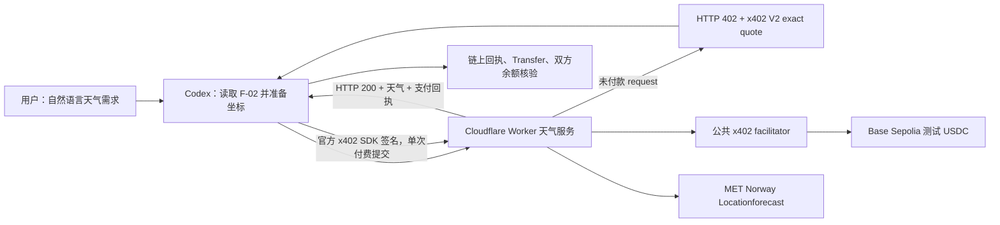

# Yoyo x402 天气服务

一个基于 **Cloudflare Workers + x402 V2 + Base Sepolia 测试 USDC + MET Norway** 的可支付天气服务。用户用自然语言提出天气需求，Codex 读取机器可读接口文档，按 quote 完成一次测试网支付，并在取得链上回执后交付天气数据。

**第一阶段已完成并通过端到端复核。** 2026-10-22 的最新真实购买返回 HTTP 402 → 200，链上精确转账 `1000` 个测试 USDC 最小单位；65 项自动化测试、30 项接口边界检查、构建、依赖审计和独立链上复查均通过。

## 给 mentor 的快速审阅路径

| 顺序 | 文件 | 看什么 |
|---|---|---|
| 1 | [Mentor 审阅指南](docs/MENTOR_GUIDE.md) | 5–10 分钟内核对目标、完成度和交易证据 |
| 2 | [最新完整复核报告](docs/第一阶段_复核报告_2026-10-22.md) | 发现的问题、修复、最终测试和真实交易 |
| 3 | [最新购买原始证据](evidence/transactions/purchase-1792639327312.json) | `documentation`、`http`、`response`、`settlement`、`receipt`、`audit` |
| 4 | [独立链上交叉核验](evidence/transactions/transaction-rpc-crosscheck-summary-2026-10-22.json) | 两个不同 RPC 对回执、区块和余额的独立结果 |
| 5 | [第一阶段验收报告](docs/第一阶段_验收报告.md) | A1–A10 与 2026-10-16 首次云端验收 |
| 6 | [证据文件清单](evidence/MANIFEST.md) | 所有公开证据的大小与 SHA256 |

已有的完整证据足够审阅，不需要再次调用 `buy`。`probe` 只读取文档、健康状态和未付款报价，不会签名或付款。

## 系统结构



- 收费接口：`GET /weather?latitude=...&longitude=...`
- 网络：Base Sepolia，`eip155:84532`
- 测试资产：`0x036CbD53842c5426634e7929541eC2318f3dCF7e`
- 单价：`1000` 原子单位，即 `0.001` 测试 USDC
- 在线服务：<https://yoyo-x402-weather.accessible-trip.workers.dev>
- 机器可读文档：<https://yoyo-x402-weather.accessible-trip.workers.dev/F-02.md>

## 已验证的云端交易

| 项目 | 结果 |
|---|---|
| 用户意图 | 查询北京现在的天气 |
| 坐标与来源 | `39.9075,116.3972`；Open-Meteo/GeoNames 北京代表点 |
| HTTP | 未付款 402；付费请求 200 |
| 天气 | MET Norway 最近时次模型预报：10.9°C、湿度 62.5%、风速 1.8 m/s |
| 买方余额 | 19.998 → 19.997 测试 USDC |
| 卖方余额 | 0.002 → 0.003 测试 USDC |
| 成功区块 | `48587561` |
| 状态 | `verified` |

交易：[0x7858f5bc9d2d3c22f9709c200f84b86f1dd2927242d126fce90bc00bf4856ff1](https://sepolia.basescan.org/tx/0x7858f5bc9d2d3c22f9709c200f84b86f1dd2927242d126fce90bc00bf4856ff1)

审计同时确认了结算回执、精确 Transfer、初始余额、最终余额和天气交付；区间内没有其他相关转账。当天一次付费响应丢失的请求在授权过期后确认未使用、未扣款，才重新执行购买。

## 仓库结构

```text
.
├── .github/workflows/ci.yml       GitHub Actions：测试与构建
├── docs/                          需求、方案、状态、F-01/F-02、验收与复核
├── evidence/                      脱敏后的原始运行、测试与链上证据
├── scripts/                       探测、购买、查账、RPC 健康检查和建钱包工具
├── src/                           Worker、收费路由与 MET Norway 适配
├── test/                          业务、支付、天气、探测和 RPC 边界测试
├── .env.example                   买方/本地运行配置样例
├── .env.cloudflare.example        Cloudflare 部署配置样例
├── wrangler.jsonc                 公开 Worker 配置
├── SECURITY.md                    发布前安全边界与检查
├── package.json
└── package-lock.json
```

本机凭据不进入仓库。`.env*`（除两个 `.example` 文件）、`.dev.vars*`、`private/` 和 `local-only/` 均在 `.gitignore` 中；依赖、构建产物和 Wrangler 缓存也不会提交。

## 本地验证

需要 Node.js 24：

```bash
npm ci
npm run verify
```

`verify` 会执行完整测试、Wrangler dry-run 构建和全仓 Markdown 链接检查；GitHub Actions 使用相同入口。更新公开证据后运行 `npm run evidence:manifest` 刷新哈希清单。

在线免费检查：

```bash
npm run probe -- https://yoyo-x402-weather.accessible-trip.workers.dev
```

预期依次得到文档 `200`、健康检查 `200`、未付款天气请求 `402`。该命令不会创建支付授权。

RPC 池只读检查：

```bash
npm run rpc-check -- --out evidence/verification/rpc-health-latest.json
```

工具默认按顺序尝试 8 个 Base Sepolia 公共节点。节点连接失败、HTTP 429 或 JSON-RPC 限流时自动切换；成功后停止，全部失败则停止并保留错误。也可通过 `BASE_SEPOLIA_RPCS` 覆盖完整列表。

## 配置与部署

从 [.env.example](.env.example) 创建本机 `.env.local`，从 [.env.cloudflare.example](.env.cloudflare.example) 创建本机 `.env.cloudflare`。买方私钥只留在本机；Worker 不读取私钥。部署令牌和账号 ID 只放在被忽略的本机文件中。

```bash
npm run build
node --env-file=.env.cloudflare node_modules/wrangler/bin/wrangler.js deploy
```

`wrangler.jsonc` 只包含公开卖方地址。Cloudflare 账号 ID、API Token、买方和卖方私钥均留在被忽略的本机配置中；生产部署与本地开发都不需要买方私钥。

## 数据与支付语义

MET Norway 返回的是天气模型中距离请求时间最近的一项预报，不是气象站实时观测。响应保留数据更新时间、预报时间、抓取时间、来源、署名和许可。

本项目复用官方 `@x402/*` SDK 完成报价、授权签名、facilitator 验证与结算，没有自建支付协议或智能合约。每次购买最多创建一个签名并提交一次付费请求；付费状态未知时必须先只读查账，不能盲目重买。

## 范围与边界

当前完成的是第一阶段：自然语言请求、文档驱动调用、真实天气数据、测试网支付和可独立核验的证据链。自主议价、复杂多 Agent 协作和生产级 SLA 不在本阶段内。公共天气源、facilitator、RPC、Cloudflare 和本机网络仍可能影响单次演示；扩大天气源使用前，还需补充运营者实际联系信息并复核提供商流量条件。
